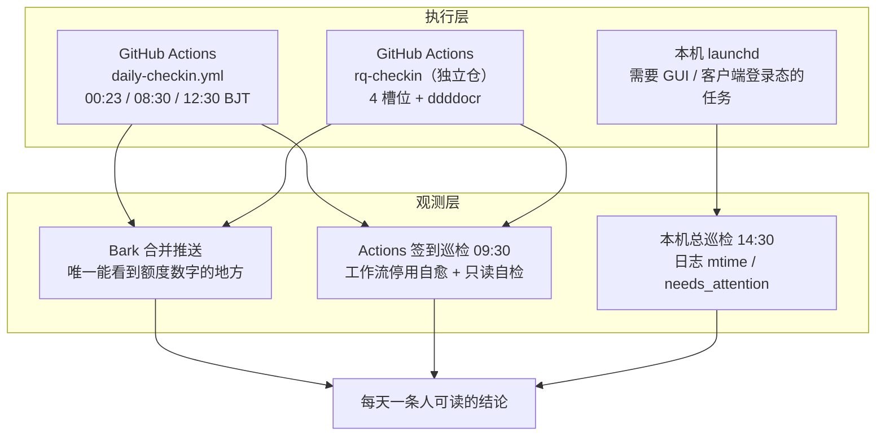

<div align="center">

# DailyCheckIn · AI 时代的薅羊毛

**把「每天点一下」变成「后台可靠运行」，以及更重要的——确认它真的到账了。**

[](https://github.com/Golden0Voyager/dailycheckin/actions/workflows/daily-checkin.yml)
[](https://www.python.org/)
[](LICENSE)

</div>

> [!NOTE]
> 这是一份**个人自用的工程笔记**，不是通用签到框架教程。
> 代码基座来自 [Sitoi/dailycheckin](https://github.com/Sitoi/dailycheckin)（MIT），上游支持 20+ 站点；
> 本仓只启用其中 4 个，另外自建了多个 AI 平台插件（Meoo / 腾讯 ima / 豆包 / WPS 灵犀），
> 并把执行、通知、巡检整条链路重做了一遍。
> **公开仓库里没有任何 Cookie / Token / API Key / 设备密钥**，凭据只存在于本机 `config.json` 与 GitHub Secret 中。

---

## 一、为什么叫「AI 时代的薅羊毛」

薅羊毛这件事本身不新鲜，变的是三件事：

| | 旧时代 | AI 时代 |
| :--- | :--- | :--- |
| **薅什么** | 网盘空间、论坛金币、签到积分 | 模型额度、Credits、算力、Token 配额、会员天数 |
| **值多少** | 基本不可变现，攒着好看 | **直接是生产资料**：能跑 Agent、能调 API、能换会员 |
| **谁在送** | 少数社区 / 网盘 | 几乎每家大模型与 AI 编程工具，按天送，抢获客 |
| **怎么领** | 页面上有个「签到」按钮 | **经常没有按钮**：当天首次带登录态调某个接口就发放（魔搭魔粒、秒悟 Meoo 都是这类） |
| **怎么丢** | 忘了点 | Cookie 30 天到期、轮换型令牌、`sk-` 与访问令牌混淆、接口返回 `+0` 但外层照打 ✅ |
| **谁在写脚本** | 人读网页、人抓包 | AI 助手一起读前端 bundle、定位私有接口、写巡检判读规则、做对照实验 |

于是核心命题从「怎么自动点」变成了：

> **怎么在平台不发任何通知、CI 全绿、日志只打一个 ✅ 的情况下，知道今天的额度到底有没有到账。**

这个仓库里大部分代码，其实都是围绕这句话写的。

---

## 二、体系全景



**注意**：Bark 直达人，不流向巡检——推送里的额度数字没有可被程序读取的历史接口，巡检只能验「是否纳入执行 / 工作流是否活着」。这正是下一节要解决的问题。

**为什么分两层执行**：纯 HTTP + Cookie 的站点全部搬到 GitHub Actions（不依赖家里那台 Mac 是否开机）；
登录态保存在桌面客户端本地、必须读 GUI 会话文件的项目留在 `launchd`。
`rq-checkin` 需要本地识别图形验证码，单独一个仓跑四个槽位。

---

## 三、当前在跑的站点

### 本仓（GitHub Actions，Secret `DAILYCHECKIN_CONFIG`）

| 平台 | 领什么 | 触发方式 | 凭据形态 | 状态 |
| :--- | :--- | :--- | :--- | :--- |
| Bilibili | 每日经验 / 投币 / 漫画签到 | 常规接口 | Cookie | 🟢 生效 |
| 什么值得买 | 签到积分 | 常规接口 | Cookie | 🟢 生效 |
| 阿里云盘 | 免费会员与空间 | 常规接口 | `refresh_token`（**会轮换**） | 🟢 生效 |
| 有道云笔记 | 存储空间 | 常规接口 | Cookie | 🟢 生效 |
| 魔搭社区 | 250 魔粒 / 日 | **当天首次调用即发放，无签到接口** | `m_session_id` | 🟢 生效 + 只读自检 |
| 秒悟 Meoo | 每日登录积分 | `GET /api/mc/entitlement/init` 的后端副作用 | 30 天一次性票据 Cookie | 🟢 生效 |
| 腾讯 ima | 50 算力 / 日 + 满签奖励 | `refresh` 换 2h token → `get_activity_info` → `check_in` | 长期 `refresh_token` + `ima_guid` | 🟢 生效 + 只读自检 |
| WPS 灵犀 | 100 智点 / 日（第 7 天 200） | `GET /tasks` → **`available` 才** `POST claim?date=` → 回查翻转 | `wps_sid` 会话 Cookie（**364 天**） | 🟢 生效 + 只读自检 |
| 豆包 | 每日签到额度 + 里程碑 | `campaign/v3/detail` → `landing/checkin` → `item/reward/claim` | 网页版 Cookie 整串 | ⚪ 插件就绪，**机房 IP 被风控，仅本机 launchd 执行** |
| New API 中转站 | 签到额度 | `POST /api/user/checkin`（404/405 回退 GET） | `access_token` + `New-Api-User` | ⚪ 模板就绪，实测站点 `checkin_enabled=false` |
| 百度网盘 | — | — | — | ⚪ 占位符，未启用 |

> 配置里 `BAIDUWP` / `NEWAPI` 仍是 `xxxxxx` 占位符，会被 `check_config()` 静默过滤，日志里不出现属于正常，不是漏签。
> 当前 Secret 共 10 个站点键，**实际生效 8 个**（2 个占位符）；`DOUBAO` 不在 Secret 里（见下方说明）。
>
> **豆包为什么只在本机跑**：同一个 Cookie，本机住宅 IP 直连 `detail` 接口正常返回，
> 换到 Actions 就固定 `HTTP 200 + code=2（会话无效，无 msg）`。这不是 Cookie 过期——
> 本地同时刻仍可用，属服务端对机房 IP / 设备环境的判定。`DOUBAO` 键已从 Secret 移除，
> 插件代码保留（本机手动跑或住宅代理可用），但**不要让它在 Actions 里常驻**，
> 否则每天都会把 CI 打红，真正的站点失败反而被淹掉。

### 兄弟项目（不在本仓，同属 `~/Code/auto_checkin/` 体系）

> 以下是体系索引，代码都不在本仓；`workbuddy-auto-signin` 来自社区项目
> [88lin/workbuddy-auto-signin](https://github.com/88lin/workbuddy-auto-signin)，此处是本地部署与排程，
> 其余为本机自建脚本。是否启用以本机 `launchd` 实际加载情况为准。

| 项目 | 领什么 | 执行入口 | 关键约束 |
| :--- | :--- | :--- | :--- |
| `rq-checkin` | RQ 币（88 天一轮，第 88 天 +25） | Actions 4 槽位 | 两道图形验证码由 ddddocr 识别；**断签清零周期** |
| `workbuddy-auto-signin`（社区项目本地部署） | WorkBuddy 积分 + Qoder CN / Intl 每日 Credits | launchd 两个 label：7 趟 / 3 趟 | 成长中心礼物需多趟收取；Qoder Intl 窗口 21:45–23:59，23:05 那趟不能删 |
| `minimax-daily-signin` | 400 积分（第 4/7 天 1000） | launchd | 轮换型 refreshToken，刷新前必须重读磁盘上的 `auth.json` |
| `raccoon-daily` | 商汤小浣熊 +300 / 延效 7 天 | launchd 3 趟 | 30 天 IAM JWT 无续期，到期人工重登 |
| `ima-daily-signin` | 腾讯 ima 50 算力 / 日、周满签奖励 | launchd 07:10 / 21:10 **+ 本仓插件（双通道）** | 领取后 7 天有效，过期作废；两通道服务端按天幂等，重复跑不会重复到账 |
| `doubao-daily-signin` | 豆包每日额度 + 500/2000/5000 里程碑 | launchd 07:20 / 21:20（**唯一入口**） | Cookie 由本机钥匙串解密；机房 IP 会被判会话无效，不能上云 |

---

## 四、本仓具体改了什么

| 改动 | 解决的问题 |
| :--- | :--- |
| `.github/workflows/daily-checkin.yml` | 三 cron 槽位；整份 `config.json` 放 Secret，运行时落地 `chmod 600`，跑完 `rm -f` 擦除；日志出现 `❌` 即让 job 变红 |
| **三个槽位而不是一个** | GitHub scheduled workflow 是 **best-effort**，实测延迟 5–8 小时且可能丢弃排队作业。把「当天兜底」下沉到调度层，不依赖本机补跑、不需要 dispatch |
| `dailycheckin/modelscope/` | 「无签到接口」类站点的模板；附带 `check_only()`，只读 GET 三个接口核算当日发放额，供巡检验收到账 |
| `dailycheckin/meoo/` | 同类机制，但**刻意不提供** `check_only()` —— 调用 `entitlement/init` 本身就会触发发放，不存在「只读」读法 |
| `dailycheckin/newapi/` | 通用 New API 签到：`Bearer` 访问令牌 + `New-Api-User`，按 `quota_per_unit` 折算，幂等处理「已签到」 |
| `message2bark()` 重写 | 原实现把整篇报告塞进 URL path（长文本会被截断）且一站一条推送；改为 `POST /push` JSON + 固定标题 + 分组，一天一条可读报告 |
| Bilibili 健壮性 | `dynamic/region` 返回 `data: null` 会 `AttributeError`，改用 `x/web-interface/newlist`；空响应不再直接 `.json()` 抛 `JSONDecodeError` |
| 配置与凭据卫生 | `config.json` 权限 600、忽略 `*.bak` / `*.tmp`、备份移出仓库目录 |
| `dailycheckin/ima/` | refreshToken 换 2h token 的三段式链路；满签格按服务端 `status=3` 判定，不锚定周日；轮换发生时报错要求更新 Secret，不静默继续 |
| `dailycheckin/doubao/` | 详情→签到→里程碑→复核四步闭环；`idempotent` 与 `biz_error` 都按正常中间态处理；鉴权失败透出服务端原文，便于区分过期与风控 |

插件机制沿用上游：`pkgutil.walk_packages` 扫子包 + `CheckIn.__subclasses__()` 反射注册。
**配置键必须等于 `cls.__name__.upper()`** —— 这条看起来理所当然，实际上是我们踩过最安静的一个坑（见下）。

---

## 五、可观测性：全绿 ≠ 到账

这是整套系统最值钱的一节。我们遇到过三种「假绿」：

| 假绿类型 | 表现 | 为什么骗过 CI |
| :--- | :--- | :--- |
| **配置键静默跳过** | 把 `Meoo` 的配置键手抄成 `MEEO`（正确是 `MEOO`） | `check_config()` 用 `data.get(键.upper())` 取不到就直接跳过，**不报错**；任务列表为空、什么都不跑，CI 全绿、Bark 照常推送 |
| **外层 ✅ 只看有没有抛异常** | Bilibili Cookie 失效时 `main()` 隐式 `return None`；Meoo 返回 `+0（未触发发放，登录态可能已失效）` | 两者都不抛异常，外层照打 `第 N 个账号: ✅✅✅✅✅`，`Report site failures` 只 grep `❌` |
| **数字只进通知** | CI 日志只有「账号数 : 1」和 ✅，`250/250 魔粒`、`+N 已到账` 只出现在 Bark 推送里 | 日志层面根本看不到额度数字 |

对策：

| 手段 | 兜住什么 |
| :--- | :--- |
| 执行清单硬检查 | 巡检必须看到 `「秒悟Meoo积分」账号数 : 1`、`「腾讯ima算力」账号数 : 1`、`「WPS灵犀签到」账号数 : 1`，任一缺失即判「Secret 未更新」而不是「今天通过」 |
| 只读 `check_only()`（仅魔搭） | 用规则表的累计发放额 `today_earned_amount` 验收；**绝不能用余额**——短期魔粒 24 小时过期，今天 +250、昨天那批同时到期，余额可能从 342 掉到 329 |
| 两个巡检自动任务 | 09:30 查 Actions 最近 3 天 + 工作流停用自愈 + 魔粒自检；14:30 查本机 launchd 日志 mtime 与 `needs_attention` |
| 工作流停用自愈 | 仓库 60 天无活动会被 GitHub 置为 `disabled_inactivity`，自动 `PUT .../enable` 重新启用 |
| 调度延迟测量 | 用 `created_at - 前一日 16:23 UTC` 算早间槽位延迟，持续变长或单日 >10h 说明验收窗口被挤掉 |

> 巡检任务本身是**只读**的：不改 Secret、不改 `config.json`、不 dispatch 补跑、不打印任何凭据。
> 对 Meoo 尤其不会做任何「自检调用」——那等于额外签到一次，既违反只读约定又招风控。

---

## 六、踩坑笔记

都是真金白银（和断签）换来的，按代价从高到低排：

1. **先花十分钟看社区怎么做，再决定要不要自己逆向。** 私有接口、设备指纹、令牌刷新通常已经有人验证过。但别人的结论必须用**对照实验**验证是否适用于本机，别照抄。
2. **配置键由 `cls.__name__.upper()` 推导，不要手抄。** `Meoo → MEOO`，写成 `MEEO` 会静默跳过且零报错。
3. **轮换型 `refreshToken` 只允许一个确定端点。** 拿它扫候选 URL，第一个成功就轮换了令牌，后续请求会把响应覆盖掉，结果是把自己踢下线。刷新响应必须**立刻原子落盘**（保留 `.bak`），并回写所有引用该凭据的位置。
4. **`sk-` 开头的模型 API Key 不是访问令牌。** New API 查用户与签到要 `access_token` + `New-Api-User`；动手前先看 `/api/status` 的 `checkin_enabled`，为 false 的平台写再多签到逻辑也没用。
5. **阿里系票据带 `.sig` 伴生项**，复制 Cookie 时必须成对，缺 sig 一定失败；这类登录态多为 30 天一次性票据，无自动续期。
6. **Secret 保存后不可回读。** 一律 `gh secret set NAME --repo owner/repo < config.json` 从文件读入；走剪贴板很容易把「要执行的命令」当成 JSON 粘进去。
7. **launchd 的 `ProgramArguments` 不要指向 Homebrew 符号链接。** 解释器一升级路径就变，任务每次启动即 `78: EX_CONFIG` 秒退且日志一个字都不写。用 `/bin/bash` + 包装脚本，运行时再解析解释器。
8. **`EX_CONFIG 78 + 日志零输出 = 程序根本没被 exec`**，别去查脚本逻辑。
9. **通知要合并。** 一个站点一条推送等于一天十几条噪音，真正异常的那条反而被淹了。
10. **服务端按天幂等，但别把「多跑几次」当重试策略。** 重复调用不重复加分，风控却比漏签贵得多。
11. **「Cookie 有效」≠「Cookie 在云端有效」。** 豆包同一个 Cookie，本机住宅 IP 调 `detail` 正常，
    GitHub Actions 固定 `HTTP 200 + code=2`（会话无效，无 msg）。判据很简单：
    **把同一份凭据拿到另一条网络立刻重试**——还失败是凭据问题，只在机房失败就是环境风控。
    这类站点别硬塞进 CI，否则天天红，真正该被看见的站点失败反而被淹掉。
12. **上云前先做一次「只读云端探测」，别靠猜。** 灵犀与豆包恰好是反例：同一个
    `dailycheckin` 仓、同一类 Cookie 凭据，灵犀在 Actions 上 `GET /tasks` 直接
    `HTTP 200 / result=ok`，豆包则被判会话无效。探测要放在临时 workflow 里只发 GET、
    不打印响应体与凭据，跑完立刻删分支 / Secret；注意 `gh workflow run` 只认**默认分支**上的 workflow。
13. **幂等没被验证过的写接口，必须先查再领。** 灵犀 `status=claimed` 时再 POST 就是碰风控，
    所以插件只在 `available` 时打一次 claim、不重试，领完再回查状态是否翻转。
    另外两个容易报错的地方：`date` 要按**北京时间**（runner 是 UTC），
    `total_claimed_credits` 是 7 天周期累计（第 3 天返回 300），不是当日额度。

---

## 七、想复用的话

```bash
# 1. 本地准备配置：模板见 docker/config.template.json，各站点字段见 docs/pages/settings/
#    config.json 已被 .gitignore 忽略，永远不要提交
cp docker/config.template.json config.json && chmod 600 config.json

# 2. 整份配置写进 Secret（从文件读入，不走剪贴板）
gh secret set DAILYCHECKIN_CONFIG --repo <owner>/<repo> < config.json

# 3. 手动触发一次，看 Bark 是否收到合并报告
gh workflow run daily-checkin.yml --repo <owner>/<repo>
gh run watch --repo <owner>/<repo>
```

站点的 `config.json` 顶层键是**数组**，天然支持多账号；值里含 `xxxxxx` 的条目会被自动跳过，可以拿它当开关。

> [!WARNING]
> **边界**：仅用于**本人账号**领取各平台公开提供的每日福利，遵守各平台服务条款。
> 不做批量注册、不共享凭据、不绕过风控或付费墙、不代他人签到、不做考勤代签。
> 任何凭据都不要写进仓库、不要打印到日志、不要贴进 issue。

---

## 八、已知债与路线

- [ ] Meoo / 魔搭登录态 Cookie 约 30 天到期，到期需人工重新登录并更新 Secret（巡检已内置提前 7 天提醒）
- [ ] `Report site failures` 目前只认 `❌`，抓不到「不抛异常的 `+0`」；下一步让站点输出 machine-readable 裁决行，由 CI 直接判定
- [ ] `requests~=2.25.1` 等旧依赖带来 Dependabot 告警，待升级并加 `pip-audit` 门禁
- [ ] Actions 里 Node / Ubuntu 版本的弃用警告待清理

---

## 致谢与许可

- 代码基座：[Sitoi/dailycheckin](https://github.com/Sitoi/dailycheckin)，MIT。其 `CheckIn` 子类 + 反射注册的插件机制非常干净，自建三个模块几乎没有改动框架代码。
- 思路调研参考了社区项目（如 `88lin/workbuddy-auto-signin`、`qixing-jk/all-api-hub` 等），只借鉴认证与失败重试的写法，未搬代码。
- 本仓新增部分同样采用 [MIT](LICENSE)。

> 本仓库记录的是工程实践，不构成对任何平台条款的建议或规避方案；额度规则随时可能变化，以各平台官方说明为准。
